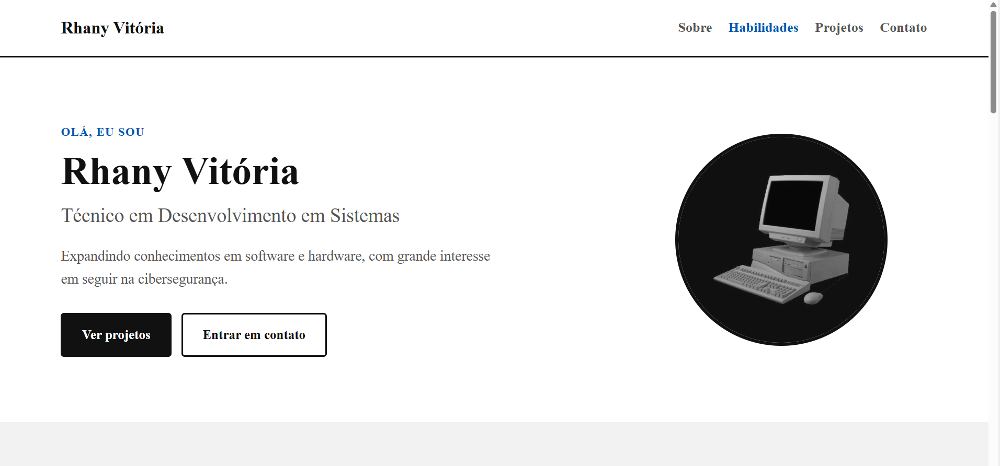

# Portfólio Pessoal — Rhany Vitória

## Objetivo do Site
Apresentar minha trajetória como técnica em Desenvolvimento em Sistemas, destacando minhas habilidades voltadas a software, hardware e o interesse em cibersegurança, além de expor projetos práticos desenvolvidos para a área tecnológica.

## Prévia do Projeto

## Tecnologias Utilizadas
- **HTML5:** Estruturação semântica de todas as seções do site (cabeçalho, início, sobre mim, habilidades, projetos, contato e rodapé).
- **CSS3:** Estilização externa em preto e branco clássico com toques dinâmicos de azul, roxo e vermelho, layout responsivo com Flexbox e Grid, além da fonte Times New Roman.
- **JavaScript:** Manipulação de eventos para interatividade e feedback visual no formulário de contato.

## Como Abrir o Projeto
1. Clone este repositório ou faça o download dos arquivos em formato ZIP.
2. Certifique-se de que a estrutura de pastas está correta (com a pasta `img` contendo as imagens necessárias).
3. Dê um duplo clique no arquivo `index.html` para abri-lo diretamente em qualquer navegador web moderno.